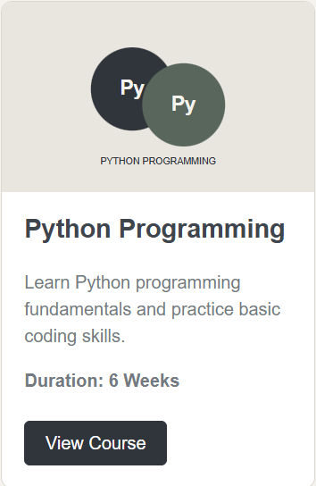
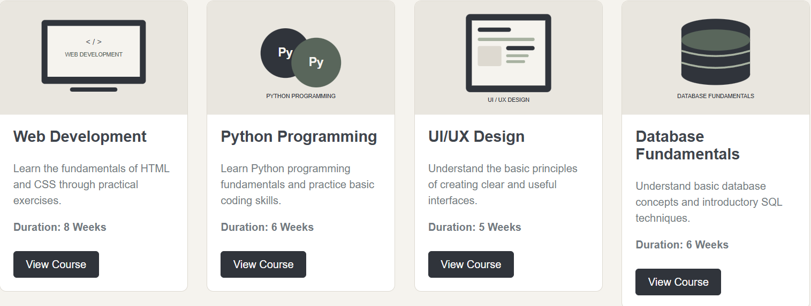
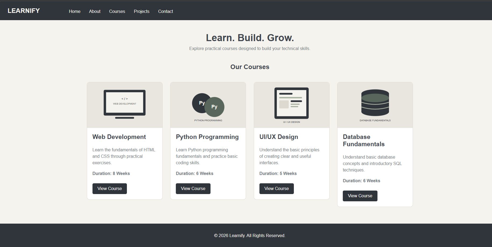

# HTML & CSS Practical Assignment

## Student Information

- **Student Name:** Sayam Shakya
- **Student ID:** 2602412449
- **Module:** Web Technologies and Platforms
- **Assignment:** Designing a Navigation Bar and Card Components Using HTML & CSS

## About the Project

This is a simple course webpage made using HTML and CSS. I kept the design clean and focused on the basic HTML and CSS concepts required for the assignment.

The webpage includes:

- A navigation bar
- An introduction section
- Four course cards
- Simple course images
- View Course buttons
- Hover effects
- A footer

The main purpose of this project is to practice basic HTML structure and CSS styling without using frameworks or advanced layout systems.

## Technologies Used

- HTML5
- CSS3

## Learning Resources

| No. | Resource | Link | Topic Learned | How I Used It |
| 1 | Teacher's Material | Class material | Basic HTML structure and page elements | Used it to understand the required structure of the webpage. |
| 2 | W3Schools | [w3schools.com/html](https://www.w3schools.com/html/) | HTML elements and basic CSS | Used it to review HTML tags and CSS syntax. |
| 3 | MDN Web Docs | [developer.mozilla.org](https://developer.mozilla.org/en-US/docs/Web/CSS) | CSS properties, margin, padding, and borders | Used it to understand and apply basic CSS styling. |
| 4 | Class / YouTube Resources | Course resources | Navigation bars and hover effects | Used them to understand simple navigation styling and `:hover`. |

## Screenshots

The screenshots below should show the implementation running in a browser. Take these yourself after opening `index.html` and save them in the `screenshots` folder.

### Navigation Bar

### Single Card

### Multiple Cards

### Complete Website

## What I Learned

While doing this assignment, I learned:

- How to structure an HTML webpage
- How to use semantic HTML elements
- How CSS selectors work
- How to change colors and backgrounds
- How to style text
- How to use margin and padding
- How to add borders and border radius
- How to add and style images
- How to create buttons using CSS
- How to add hover effects
- How to align elements using basic CSS and `inline-block`
- How to organize a simple web project

## Challenges and Solutions

### 1. Navigation Bar Spacing

At first, the navigation links did not have the spacing I wanted. I fixed this by using `margin` and `inline-block` to position the links properly.

### 2. Keeping the Course Cards Consistent

I had to make sure all four cards looked consistent. I used the same card width, image height, padding and minimum height for each card.

### 3. Choosing Simple Images

The first version used one placeholder image for every course. I replaced it with four simple course-specific SVG images so each card has its own image while keeping the page clean and lightweight.

## AI Usage

I used ChatGPT as a learning assistant while working on this assignment. I used it to understand some HTML and CSS concepts and to get help with things like navigation bars, cards, spacing, images and hover effects.

I checked and tested the code myself in the browser and made changes where needed. I also kept the final design simple instead of adding unnecessary features.
